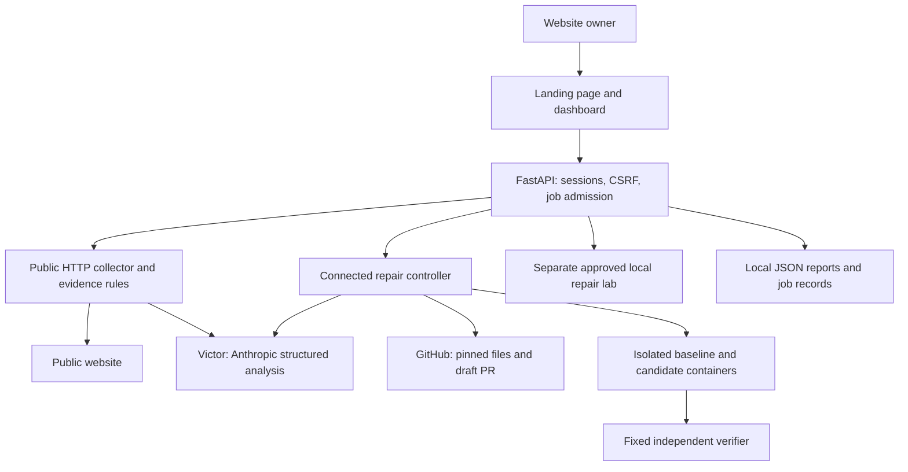

<p align="center">
  <picture>
    <source media="(prefers-color-scheme: dark)" srcset="src/patchpilot/static/assets/sewn-logo-dark.svg">
    
  </picture>
</p>

# sewn

**Find a security issue. Prepare a tested fix. Keep the owner in control.**

sewn helps small businesses and nonprofits understand observable security issues on their PHP websites and turn supported findings into reviewable GitHub changes. Its Anthropic-powered agent, **Victor**, collects fresh website evidence, explains the findings, proposes a constrained repair, and shows independent verification before a draft pull request is created.

**Status:** working local MVP with a real website-to-draft-PR demonstration. Public assessment is available for public URLs; automated repair currently supports four PHP configuration settings in repositories that meet the connection contract. The Python package and repository retain the original `patchpilot` name.

[Quick start](#quick-start) · [User flow](#user-flow) · [Architecture](#architecture) · [Repository setup](#connect-a-php-repository) · [Testing](#development-and-testing) · [Roadmap](#technical-roadmap)

## Why this project exists

Website owners often receive security findings without a practical way to act on them. A suggested patch also raises another question: will the homepage, contact form, or upload still work afterward?

sewn connects evidence, a small proposed change, and repeatable checks in one workflow. Owners start with their website URL. Repository access is requested when they want a tested repair, and publication requires a separate review action. Maintainers can inspect the exact diff, check results, and model provenance rather than relying on an unexplained success message.

## What works today

| Workflow | Input | Result | Changes a deployment? |
| --- | --- | --- | --- |
| Website assessment | Public HTTP(S) URL | Fresh HTTP evidence, PHP indicators, findings, and Victor's suggested fixes | No |
| Connected GitHub repair | Completed assessment, matching repository, deployment marker, and supported profile | Baseline/candidate checks, exact configuration diff, and an owner-requested draft PR | No; merging and deployment remain manual |
| Repair lab | Explicitly approved, registered local Docker fixtures | Staging, activation, live verification, recipe reuse, and restoration on failure | Yes, within the registered local lab |

Public assessment examines the submitted page and its bounded redirects. It is not a crawler or a comprehensive penetration test. A PHP version banner is reported evidence, not proof of the installed build or its backported fixes. Arbitrary PHP source repairs, dependency upgrades, and production deployment are outside the connected MVP.

## Quick start

Run from a repository checkout. The application serves the landing page, dashboard, API, and assets from one local address.

| Requirement | Needed for |
| --- | --- |
| Python 3.12+ and `uv` | Application and Python tests |
| Anthropic API key | Live Victor analysis and repair proposals |
| Docker engine with Linux amd64 or arm64 containers | Connected repair verification and the repair lab |
| GitHub CLI authentication or `GITHUB_TOKEN` | Connecting repositories and creating draft PRs |
| Node.js; optionally Playwright and axe-core | Frontend verification only; no frontend build step |

```bash
git clone https://github.com/ayyagarisujanreddy123/PatchPilot.git
cd PatchPilot
uv sync --locked --extra dev
test -f .env || cp .env.example .env
```

Edit the ignored `.env` and replace the placeholder key. Keep an existing `.env` intact.

```dotenv
ANTHROPIC_API_KEY=your-anthropic-api-key-here
ANTHROPIC_MODEL=claude-sonnet-5-5
# Optional; otherwise use gh auth login on this computer.
# GITHUB_TOKEN=your-repository-scoped-token
```

Start one controller process:

```bash
uv run --locked --extra dev uvicorn patchpilot.backend.app:app \
  --host 127.0.0.1 --port 8765 --workers 1
```

Open **[http://127.0.0.1:8765](http://127.0.0.1:8765)** for the landing page or **[the dashboard](http://127.0.0.1:8765/dashboard)** to begin. Website assessment needs no Docker setup. For Docker workflows, ensure the server process can reach the intended engine; optionally prefix the start command with `DOCKER_CONTEXT=YOUR_CONTEXT`.

## User flow

1. **Enter a website URL.** Use a public page you own or are authorized to assess. A demo selection fills the form; it does not preload a result or start an assessment.
2. **Watch Victor work.** The server collects a normal HTTP response, derives observations, and streams Anthropic analysis into recorded activity. Failures retain partial evidence and an explicit error.
3. **Review the findings.** The dashboard presents a short overview first. Expand a fix for its steps and suggested code, or open technical evidence for response fingerprints, PHP detection, coverage, and actual model/token provenance.
4. **Connect the matching GitHub repository.** For a supported website, select the functions to preserve and verify its repository/deployment identity.
5. **Prepare a tested fix.** The controller checks a baseline, asks Victor for an allowlisted proposal, and tests the exact candidate against the same independent checks.
6. **Review and publish.** A passing candidate unlocks **Create draft pull request**. Review the diff and results before selecting it. The owner then reviews, merges, deploys, and checks the deployed website separately.

An assessment marked complete means evidence collection and analysis finished. A passing candidate means the selected sandbox checks passed. Neither result certifies that the whole website is secure.

### Try the complete demonstration

The [connected repair walkthrough](docs/demo/connected-repair.md) records a real browser, Anthropic, Docker, and GitHub run: the candidate passed **11/11 checks**, including a real 3 MiB upload, and produced a [draft repair PR](https://github.com/ayyagarisujanreddy123/patchpilot-connected-demo/pull/1). This is recorded acceptance, separate from tests that use doubles.

To reproduce it with your own dedicated demo repository, run the commands below. The setup script creates a **public** GitHub repository if it is absent, pushes the curated demo code to its `main` branch, and starts the Docker demo. Use a dedicated demo repository; this is separate from the sewn application repository.

```bash
gh auth login
uv run --locked --extra dev python scripts/setup-connected-demo.py \
  --repository YOURLOGIN/patchpilot-connected-demo --port 8085
cloudflared tunnel --url http://127.0.0.1:8085 --no-autoupdate --protocol http2
```

Keep the PHP server/container and tunnel running, then assess the generated public HTTPS URL. `cloudflared` is optional tooling for this demo; its quick-tunnel address is temporary. Follow the walkthrough for sample metadata. The [demo website guide](docs/demo/demo-sites.md) distinguishes assessment-only examples from the owned repository-repair example.

## Architecture



The backend owns policy and execution. Victor proposes structured changes; it cannot run commands, choose arbitrary files, rewrite the verifier, or authorize publication. Browser updates use active JSON polling; the Anthropic worker consumes the provider stream and records actual progress.

| Module | Responsibility |
| --- | --- |
| `webscan/` | Public destination validation, bounded HTTP collection, evidence rules, and analysis |
| `repairs/` | GitHub identity checks, configuration policy, Victor planning, sandbox checks, and PR publication |
| `backend/` | API routes, sessions, shared job admission, durable records, and recovery |
| `core/` | Local repair-lab assessment, approvals, planning, controller, and recipe policy |
| `runtime/` | Local fixture lifecycle, HTTP verification, activation, restoration, and reset |
| `shared/` | Typed contracts, ports, and settings |
| `static/` | HTML, CSS, ES modules, views, and supplied sewn branding |

### Repository layout

```text
src/patchpilot/                 Application modules listed above
tests/                         Backend, webscan, repairs, core, and runtime tests
examples/php-community-site/   Supported connected-demo PHP application
fixtures/                      Registered local PHP/Apache lab fixtures
config/                        Lab fleet and advisory configuration
scripts/                       Connected-demo setup and browser verification
docs/specs/                    Website and connected-repair contracts
docs/demo/                     Walkthroughs and recorded acceptance
docs/design/                   Interface behavior and accessibility guidance
tasks/                         Original implementation and team plans
var/                           Ignored runtime records and scratch data
```

## Connect a PHP repository

Authenticate the local operator with `gh auth login`, or configure `GITHUB_TOKEN` outside Git. The account needs write access, including repository contents and pull requests. The dashboard accepts repository root URLs, `.git` URLs, and browser `/tree/...` links; it always resolves the repository's **default branch**.

The assessed homepage must serve `/.well-known/patchpilot.json` from the same origin:

```json
{
  "repository": "OWNER/REPOSITORY",
  "commit": "FULL_40_CHARACTER_DEFAULT_BRANCH_HEAD_SHA",
  "siteId": "community-site"
}
```

The repository must contain a root `.patchpilot.json` profile, for example:

```json
{
  "schemaVersion": 1,
  "siteId": "community-site",
  "documentRoot": "public",
  "phpIni": "config/php.ini",
  "capabilities": ["homepage", "contact", "upload"],
  "homepage": "/",
  "contact": "/contact.php",
  "upload": "/upload.php"
}
```

The marker, site identity, and default-branch commit must agree. Assessments and connections must be fresh; preparation rechecks identity. This is a declared deployment link, not cryptographic build attestation. The marker belongs to the demo/deployment process rather than a file containing its own commit hash.

Supported applications use the profile's simple homepage/contact/upload contract. The MVP does not run Composer, repository installers, arbitrary Dockerfiles, databases, or application-specific browser journeys. Read the [complete connection specification](docs/specs/verified-github-repairs.md) and the [concrete PHP example](examples/php-community-site/) for the expected contact/upload responses before adapting another repository.

### Repair policy and verification

The connected repair can change only these settings in the declared PHP INI file:

```ini
display_errors = Off
display_startup_errors = Off
log_errors = On
expose_php = Off
```

All other settings, including upload/post limits, and all application source remain unchanged. Both baseline and candidate use the same pinned PHP 8.3.36 image. This workflow hardens configuration; it does not upgrade the deployed PHP runtime. The sandbox uses PHP's built-in server inside the official Apache image, so passing results do not establish production Apache/rewrite equivalence.

With all capabilities selected, each phase runs 11 fixed checks: runtime version; four settings and hidden PHP banner; homepage; valid/invalid contact responses; and upload byte count/hash. The upload uses a real random 3 MiB payload. Contact checks validate response behavior, not email delivery. Baseline business/runtime checks must pass; candidate checks must all pass. Missing, duplicated, or inconsistent evidence rejects the repair.

The sandbox uses pinned images, read-only source/root filesystem, a non-root application process, a separate verifier identity, temporary writable storage, and bounded resources/time. It has no external network access, published ports, host credentials, or Docker socket; HTTP verification uses container-local loopback. Source and configuration sizes are bounded; unsupported file types and profiles fail closed. Owned scratch/container/image cleanup runs afterward; this is not a claim of forensic Docker-cache erasure.

Publication reconstructs and hashes the exact verified candidate, rechecks the default-branch head, and creates a deterministic repair branch and **draft** PR. Idempotent retry handling reconciles uncertain GitHub outcomes instead of blindly creating another PR. It never force-updates the default branch, merges the repair, or deploys it.

## Security, data, and operating model

- **Public collection:** HTTP(S), ports 80/443, public destinations only. Credentials and query parameters are rejected. Every DNS answer and redirect is validated; connections pin the validated address with TLS verification. Collection is limited to normal GETs, up to three redirects, a 30-second collection budget, and bounded response sizes.
- **Model boundary:** normalized observations and supported configuration/check facts go to Anthropic. Full website HTML, cookie values, repository source, credentials, and raw diagnostic paths are excluded. Provider failure remains visible; simulated or cached results never replace failed live analysis.
- **Local authentication:** an eight-hour HttpOnly, SameSite=Strict operator cookie scopes website and connected-repair reports. Lab run history is shared by the local controller. Mutations require CSRF and same-origin checks. GitHub access uses the local operator's credentials, not a hosted OAuth connection.
- **Execution:** run one controller with `--workers 1`. A data-directory process lock and shared exclusive admission prevent overlapping scan, connected-repair, and lab operations. Busy requests return 409; start-rate limits return 429.
- **Records:** website reports live under `var/website-assessments/`; connections and repairs under `var/repository-repairs/`; lab runs/events under `var/runs/`, with recipes under `var/recipes/`. Reports include real evidence and provider provenance. Repository scratch data is materialized locally during verification.
- **Restart behavior:** records persist, but operator sessions are held in memory. Restart or expiry invalidates access through that session; account-based history recovery is not implemented. Interrupted jobs are reconciled or marked failed rather than reported as completed.

This is a local, single-controller prototype. Public multiuser hosting needs account authentication, durable authorization/history, a GitHub App or OAuth integration, and an isolated worker deployment model before launch.

## Separate repair lab

Open `/dashboard#/fleet` and select **Prepare demo sites** to create the four registered local PHP/Apache fixtures on ports 8081–8084. Assess sites, review their fingerprints, approve the exact scope, and start a repair. The lab stages a candidate, verifies it, activates it at the original local URL, and repeats the checks. A failed activation triggers restoration; a restored vulnerable original remains unpatched.

The lab demonstrates runtime/configuration repair and verified recipe reuse across compatible fixtures. Reset affects project-owned resources and retains completed run records. The explicit simulation at `/dashboard?mock=1#/fleet` is labeled simulated and is separate from live website assessment. See the [lab demo guide](docs/demo/demo-script.md) and [core guide](src/patchpilot/core/README.md).

## API overview

Read the generated API schema at `/openapi.json`. Start with `GET /api/session` to obtain the session cookie and `{csrfToken}`. Send `X-CSRF-Token` and a matching `Origin` or `Referer` on mutations.

| Endpoint | Purpose |
| --- | --- |
| `POST /api/website-assessments` | Submit `{url}`; returns an assessment ID and status URL |
| `GET /api/website-assessments/{id}` | Read evidence, activity, analysis, and errors |
| `GET /api/website-assessments/examples` | Read sample metadata; no stored assessment result |
| `GET /api/repository-connections/status` | Check local GitHub authentication availability |
| `POST /api/repository-connections` | Verify assessment/repository/profile identity and selected capabilities |
| `POST /api/repository-repairs` | Submit `{connectionId}` for baseline and candidate verification |
| `GET /api/repository-repairs/{id}` | Read exact diff, checks, provenance, and publication state |
| `POST /api/repository-repairs/{id}/pull-request` | Publish the reviewed candidate with an `Idempotency-Key` |

Website states are `QUEUED → COLLECTING → ANALYZING → COMPLETED`, or `FAILED`. Connected repairs progress through fetch, baseline, planning, and staging to `READY_TO_PUBLISH`, then `PUBLISHING → PUBLISHED` after explicit publication. `NO_CHANGE`, `REJECTED`, and `FAILED` remain distinct outcomes. Website and repository list endpoints return only the issuing session's records. Lab routes retain `/api/sites`, `/api/prepare`, `/api/assessments`, `/api/approvals`, `/api/runs`, and `/api/resets`, with controller-shared run history.

## Development and testing

Dependencies are locked in `uv.lock`. The frontend uses native ES modules and system fonts; there is no Node dependency installation or asset compilation required to run it.

```bash
# Deterministic Python checks: no Docker, live model, or browser required
uv run --locked --extra dev python -m pytest -p no:cacheprovider \
  -m 'not docker and not live_model and not ui'

# Frontend contract checks with test doubles; no live target requests
node src/patchpilot/static/scripts/verify-website.mjs
node src/patchpilot/static/scripts/verify-api.mjs
node src/patchpilot/static/scripts/verify-repository-repairs.mjs
node src/patchpilot/static/scripts/verify-mock.mjs

# Real Docker verification; select DOCKER_CONTEXT if required
uv run --locked --extra dev python -m pytest -p no:cacheprovider \
  -m docker tests/repairs/test_sandbox_docker.py tests/runtime

# Package and whitespace checks
uv build
git diff --check
```

Pytest uses `test_*.py` files and `test_*` functions; opt-in markers are `docker`, `live_model`, and `ui`. No repository-wide coverage threshold or formatter/linter gate is configured. Browser verification with Playwright/axe is documented in the [frontend guide](src/patchpilot/static/README.md). Keep deterministic tests, real Docker checks, browser checks, and live provider acceptance clearly distinguished.

Use four-space Python indentation, type hints, `snake_case` functions/modules, and `PascalCase` classes; preserve camelCase wire contracts. Work on a focused branch from current `main`, use descriptive commits such as `fix: preserve upload limits`, and include behavior, relevant specification links, verification results, and screenshots for UI changes in PRs. Keep `.env`, tokens, runtime records, and generated artifacts out of commits. Never weaken a verifier to make a candidate pass.

## Technical roadmap

These are planned extensions, not current product claims.

| Stage | Work | Acceptance goal |
| --- | --- | --- |
| Broaden supported PHP sites | Explicit framework/configuration profiles and app-specific business checks | A second real application completes the same reproducible baseline/candidate/PR workflow |
| Support hosted teams | GitHub App/OAuth, accounts, durable report ownership, isolated queued workers | Multiple owners can use separate credentials and recover their authorized history |
| Close the deployment loop | Owner-approved deployment integration, production checks, and rollback policy | A merged change is verified on the actual deployed website with an auditable outcome |
| Expand repair coverage | Carefully scoped source/dependency repairs, stronger regression suites, and recurring assessments | Every new repair class has fixed checks, reviewed boundaries, and real acceptance evidence |

## Further reading

- [Live website assessment contract](docs/specs/live-website-assessment.md): collection, findings, provider behavior, and API boundaries.
- [Verified GitHub repair contract](docs/specs/verified-github-repairs.md): identity, configuration policy, sandbox, and publication guarantees.
- [Connected demo and acceptance](docs/demo/connected-repair.md): reproduce the real URL-to-PR workflow.
- [Demo website options](docs/demo/demo-sites.md): which examples support assessment or connected repair.
- [Interface design](docs/design/interface.md) and [focused workspace](docs/design/intuitive-workspace.md): interaction, accessibility, and disclosure behavior.
- [Original team plan](tasks/team-plan.md): hackathon ownership and historical task breakdown; current capabilities are described above and in the implemented contracts.
