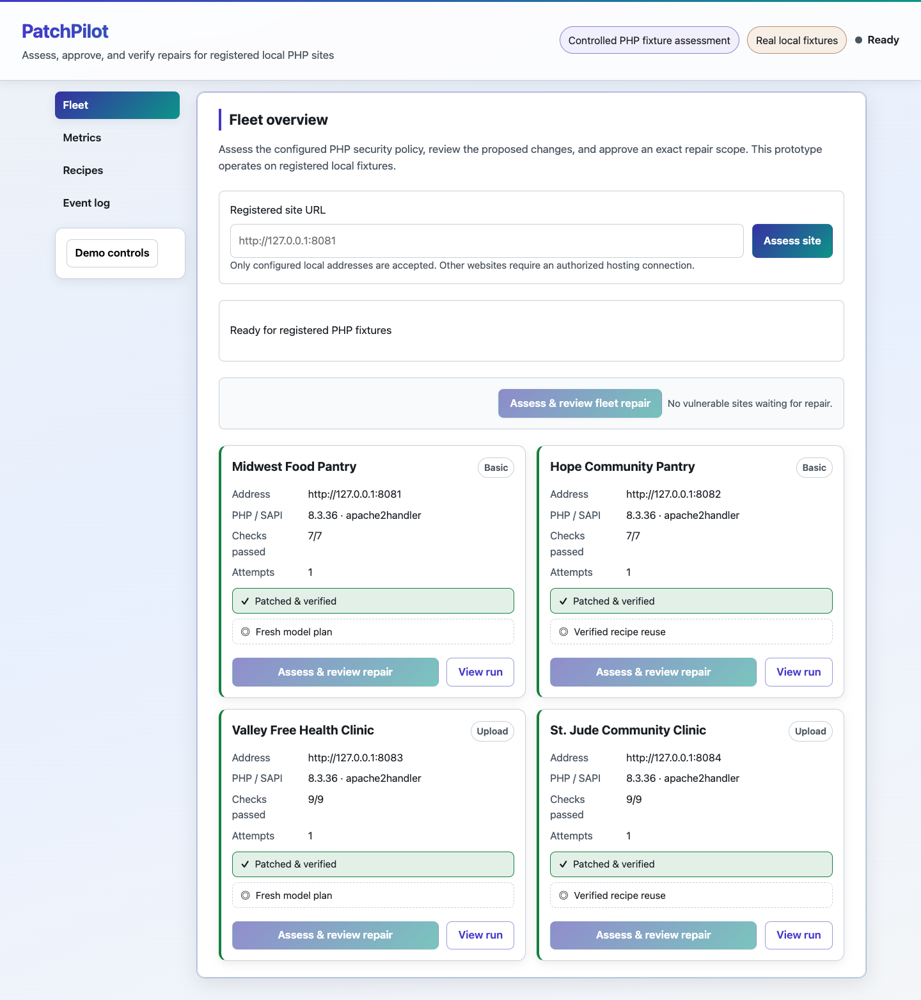

# PatchPilot Demo Guide

## Default demo: a real public website

The dashboard's default task accepts a real public URL, collects fresh HTTP
responses, and requests Anthropic guidance grounded in recorded observations.
Show the collection, actual agent progress, evidence-linked findings, suggested
fixes, and uncertainty. This procedure describes the implemented flow; record
current live acceptance separately with its actual report and provenance.

Public website assessment uses bounded normal GET requests. It observes public
PHP signals, transport, response headers, and configuration indicators; it does
not establish a full penetration test or apply changes to the remote server.
Installed package/backport status and source-level vulnerabilities require
additional authorized access. The local fixture repair remains a separate lab.

## Launch once, open one URL

Follow installation and Anthropic configuration in [README](../../README.md).
Keep the ignored `.env` local. From the repository root, run one process:

```bash
uv run --locked --extra dev uvicorn patchpilot.backend.app:app --host 127.0.0.1 --port 8765 --workers 1
```

Open **[http://127.0.0.1:8765/dashboard](http://127.0.0.1:8765/dashboard)**.
The initial page is **Website assessment**. This flow needs no Docker preparation,
fixture selection, or repair approval. The landing page is available at `/`.

## One-site walkthrough

1. Select **Try the PHP demo** to fill `http://php.testsparker.com/`. Explain
   that this is a public sample URL, not a saved report. The button fills the form
   only. Each start collects fresh responses.
2. Select **Assess website**. The assessment receives its own ID and report URL.
   Watch `QUEUED` become `COLLECTING`; **Live agent activity** records the actual
   collection messages and timestamps.
3. During `ANALYZING`, point out **Anthropic agent is working** and the actual
   provider-generation message. Character counts come from received stream text;
   the screen does not invent percentages or wait through a canned animation.
   Fast responses may produce only a few updates.
4. Open **View technical evidence** to inspect status, elapsed time, bytes read, body
   SHA-256, header names, and any truncation. Follow **View evidence** from a finding
   to its timestamped observation. Recorded values can change between assessments.
5. Explain PHP confidence: `REPORTED` is a public response claim, `INFERRED` is a
   weaker signal, and `UNKNOWN` means PHP/version was not confirmed. A banner does
   not prove an installed binary or vendor backport status.
6. At **Ready to review**, show the overview and **What to fix first**. Open a
   **Review fix** row for explanation, steps, and verification. **View suggested
   code** reveals code only when needed. All observations remain under **All findings**.
   Within **View technical evidence**, **Analysis provenance** shows the actual
   model/message/token usage. Partial stream text is not accepted as a fix.
7. Read **Coverage & limitations** inside technical evidence. A completed assessment describes this evidence
   and analysis; it does not declare the website safe or claim a verified repair.
   Applying suggestions requires owner review and authorized server/source access.

Use **Check again** for a fresh report. Assessments belong to the issuing
browser session. A controller restart invalidates that session; create a fresh
assessment after restarting.

## Failure behavior

If collection or Anthropic fails, show the `FAILED` state, error, and any partial
observations that remain. Missing provider configuration can leave collected HTTP
evidence available without AI recommendations. Correct the reported prerequisite
and start a fresh assessment. Never substitute a fixture report, saved sample,
simulated AI response, or invented success for failed live work.

The form accepts public HTTP(S) on ports 80/443 without credentials or query
parameters. Private/reserved destinations and unsafe redirects are excluded.
Assessment starts share operation admission with the lab; conflicting work returns
409, and start limits return 429. Follow the reported error rather than starting
another controller process.

## Separate repair-lab walkthrough

Select **Repair lab**, or visit `/dashboard#/fleet`. Follow the authorized Docker
context instructions in [README](../../README.md); this is a separate task with
local deployment authority.

1. Select **Prepare demo sites** when required. Preparation resolves the approved
   image digest, builds the project fixtures, and checks ports 8081–8084.
2. Enter `http://127.0.0.1:8081` and select **Assess site**, or assess the eligible
   local fleet. Review actual PHP/configuration findings, changes, and checks.
3. Approve the displayed scope. Follow isolated staging and repeated checks at
   the original address after activation. Upload fixtures perform a real 3 MiB
   upload and verify byte count and hash.
4. Inspect per-site results, model/verified-recipe provenance, and recovery evidence.
   A restored original is reported as unpatched.

For a repeat, open **Workspace controls**, optionally select **Also clear recipe
memory**, and choose **Reset fleet**. Confirm the reset. It restores the vulnerable
project baseline while retaining historical reports. Current site rows must stop
claiming a patched state.

`/dashboard?mock=1#/fleet` is the explicitly labeled simulated repair-lab walkthrough.
Its scripted faults and recovery are useful for explaining the UI, but provide no
real deployment or public-website evidence. It is not a website-assessment fallback.

## Recorded live website acceptance

A browser-driven assessment of `http://php.testsparker.com/` completed on
2026-10-24 with fresh HTTP evidence and a real Anthropic response:

| Recorded field | Value |
| --- | --- |
| Assessment | `website-8575b23863d44e81ae574a644c9bf4be` |
| Created / finished (UTC) | `18:42:35.254952` / `18:42:46.280474` |
| Response | HTTP 200; 136 bytes; 114 ms; not truncated |
| PHP signal | `REPORTED`, version `5.2.6`; a public header claim, not installed-build proof |
| Findings / validated fixes | 6 / 3 |
| Analysis source / model | `ANTHROPIC` / `claude-sonnet-5-5` |
| Provider message | `msg_011CgMZ6FzCFBaRN9diTeaYE` |
| Input / output tokens | 2,787 / 1,253 |

The response body SHA-256 was
`700d35e46750c7cc3ad5b7481d3f2c5001a5e8fb9b4b85967fe71e28d42e5b95`.
The report contains 14 activity events, including eight generation updates based
on actual received stream text. The browser rehearsal reported no JavaScript
errors. These values describe that snapshot, not a performance benchmark or a
claim that the target was repaired or comprehensively tested. The complete report
and screenshots remain local; no full report JSON is committed here.

## Previously recorded repair-lab acceptance


On 2026-10-24, browser-driven run
`run-77575165a53d49c9b6d4f3c622379696` completed with actual Anthropic proposals:

| Site | Plan source | Live checks | Observed PHP |
| --- | --- | --- | --- |
| pantry-a | MODEL | 7/7 | 8.3.36 |
| pantry-b | VERIFIED_RECIPE | 7/7 | 8.3.36 |
| clinic-a | MODEL | 9/9 | 8.3.36 |
| clinic-b | VERIFIED_RECIPE | 9/9 | 8.3.36 |

All four reported complete evidence and disabled upload-progress tracking. The run
contains 96 baseline, staging, and live checks, including 32 passing live checks.
Local evidence remains under `var/runs/<runId>/`; it is intentionally ignored by
Git. This is deployment acceptance, not a benchmark or a claim of broad security
coverage.

A reset restored all four 8.3.35 baselines, cleared recipes, and preserved that
report. A second browser-driven run,
`run-2568db06fb8a4e57b480718e42019301`, repeated the same verified outcomes and
recorded each site's provider provenance separately.



[Mobile dashboard screenshot](fleet-mobile.png)

## Validation commands

Deterministic website/backend and client-contract checks:

```bash
uv run --locked --extra dev python -m pytest -p no:cacheprovider tests/webscan tests/backend
node src/patchpilot/static/scripts/verify-website.mjs
node src/patchpilot/static/scripts/verify-api.mjs
```

The frontend contract scripts use test doubles and make no public network or
Anthropic requests. Keep those results separate from a live one-site rehearsal.

On 2026-10-24, the guarded `scripts/verify-ui.cjs` harness passed 19 checks with
axe enabled. It covered the default website form and fill-only sample, responsive
and keyboard behavior, polling persistence, and retained simulated lab workflows.
It reported no browser errors, external requests, or HTTP writes and started no
real website assessment or provider call.

Repair-lab acceptance and scripted playback:

```bash
DOCKER_CONTEXT=lima-patchpilot-demo uv run --locked --extra dev python -m pytest -p no:cacheprovider -m docker tests/runtime
node src/patchpilot/static/scripts/verify-mock.mjs
uv build
```

The historical repair-lab Python gate passed 162 tests, including Docker tests,
on 2026-10-24. That count predates the public website feature and is not its current
acceptance result. The earlier API/mock and browser/provider rehearsals belong to
that recorded lab milestone.

Record new live website acceptance separately: target URL, assessment ID,
created/finished timestamps, response status/bytes/hash, PHP confidence, findings,
actual provider model/message ID and usage, and any failures or limitations.
