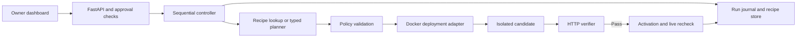

# PatchPilot Implementation Plan

Status: core implementation in progress on `feature/sujan-core`. Prepared 24 October 2026.

## 1. Deliverables and scope

Build the prototype defined in [the technical statement](../PatchPilot_Technical_Statement.md), with the owner experience described in [the product statement](../PatchPilot_Product_Statement.md). Execution tasks and checkpoints are tracked in [todo.md](todo.md). Four-person ownership, immediate starting tasks, shared interfaces, and integration order are defined in [team-plan.md](team-plan.md).

The first delivery is a working local application: four real Apache/PHP Docker sites, owner approval, isolated repair candidates, unchanged HTTP verification, activation, recovery, verified recipe reuse, and an evidence dashboard. Two sites need homepage/contact behavior; two also need uploads. Process sites sequentially.

The product connection flow is website URL → supported hosting connection or installed agent → assessment → approval → repair report. For the prototype, the four sites are registered in a trusted manifest and selected from the dashboard. A URL identifies a site; the deployment connection supplies authority to change it. Runtime repairs deploy to the connected environment. Source-code pull requests are a separate future capability.

Production delivery requires the hosting, identity, durability, and operational work in section 13. Completing the local demonstration does not establish production readiness.

## 2. Current state and prerequisites

The core implementation and its tests are described in [the core integration guide](../src/patchpilot/core/README.md). Package bootstrap, runtime adapters, backend, and UI remain separate workstreams. Inspection of this task's shell found `/usr/bin/python3` at Python 3.9.6 and no `uv` or `docker` executable on PATH. Confirm installed applications and PATH before assuming they need installation.

Before runtime work:

1. Provision a project-managed Python 3.12 environment, uv, and an available Docker engine without replacing macOS Python. Pin package and tool versions during scaffolding.
2. Resolve original and patched PHP/Apache images for the laptop architecture, pull them, and record immutable digests. A pre-fix 8.3 image must be verified rather than guessed from a tag name.
3. Use the selected Anthropic provider. Configure `ANTHROPIC_API_KEY` and `ANTHROPIC_MODEL` in the local `.env` or environment. The implemented adapter bounds output to 1,024 tokens and disables automatic SDK retries. Complete its live acceptance check before claiming model-driven results.

The specification's first working upgrade within 75 minutes remains an early target. Record setup, image acquisition, and implementation time separately; report a missed target rather than changing its starting point afterward.

## 3. Stack and architecture

| Layer | Proposed implementation | Reason |
| --- | --- | --- |
| Runtime and packaging | Python 3.12, uv, `pyproject.toml`, committed `uv.lock` | One reproducible project environment. |
| API and dashboard | FastAPI, Uvicorn, Jinja2, plain CSS and JavaScript | One application serves pages and JSON; no separate frontend service. |
| Contracts | Pydantic models | Validate manifest, API, persisted records, and model output at their boundaries. |
| Deployment adapter | Docker SDK for Python | Fixed container operations and structured parameters. |
| Verification | HTTPX against the actual serving application | Check runtime and behavior through HTTP. |
| Planning | Official Anthropic SDK with a strict JSON-schema proposal | Use the selected API credits while keeping execution separate from model output. |
| Persistence | JSON snapshots, per-run NDJSON journals, atomic file replacement | Sufficient for one local controller; retain evidence across restarts. |
| Quality tools | pytest, Ruff, mypy, Playwright for Python | Test decisions, Docker behavior, API contracts, and browser flows. |

Use FastAPI's lifespan to own one repair worker, client lifetimes, and startup reconciliation. Run one Uvicorn process; keep blocking Docker/model calls off the request event loop. Use polling for progress initially. FastAPI documents lifespan as its recommended startup/shutdown mechanism. [FastAPI lifespan documentation](https://fastapi.tiangolo.com/advanced/events/)

Use uv's lockfile and project commands for setup, execution, and packaging. Exact dependency versions are selected and frozen in Task 01. [uv project documentation](https://docs.astral.sh/uv/guides/projects/)



The planner returns data; the controller holds deployment authority. The verifier and policy cannot be edited through a repair plan.

## 4. Proposed repository layout

Use exclusive package boundaries from the team plan. Shared interfaces are owned by Teammate 3; core and runtime implementations consume them without importing backend route handlers.

```text
config/
  advisories.json          # Sujan: approved policy, revisions, images, profiles
  fleet.json               # Teammate 2: four registered targets/capabilities
fixtures/                  # Teammate 2: fixed Dockerfile and PHP fixture code
src/patchpilot/
  core/                    # Sujan: assessment, controller, AI, policy, recovery, memory, fleet, CLI
  runtime/                 # Teammate 2: deployment, verification, reset, fixture CLI
  shared/                  # Teammate 3: contracts, ports, shared settings
  backend/                 # Teammate 3: app, routes, storage, reconciliation
  web/                     # Teammate 4: all templates, CSS, JS, dev previews
    templates/
    static/
tests/
  core/                    # Sujan: unit and integration checks for core behavior
  runtime/                 # Teammate 2: Docker, HTTP, reset, restoration
  backend/                 # Teammate 3: API, persistence, startup coordination
  ui/                      # Teammate 4: real browser journeys
  conftest.py              # Teammate 3: common fixtures; private fakes stay local
scripts/rehearse.py        # Sujan: evaluation/rehearsal orchestration
docs/demo/                 # Teammate 4: presentation and recording instructions
docs/decisions/            # Teammate 3: accepted platform decisions
tasks/                     # Sujan: implementation plan, tasks, team assignments
var/                       # Gitignored runtime records, recipes, locks, evaluations
```

Use four-space indentation, Python type hints, descriptive module names, and the conventions in [AGENTS.md](../AGENTS.md). Keep fixtures and generated evidence separate. Test directories indicate ownership; pytest markers (`docker`, `live_model`, `ui`) identify runtime prerequisites.

## 5. Security policy and fixture behavior

For the controlled PHP 8.3 branch, use the approved 8.3.36 release for CVE-2026-109618 and CVE-2026-109619. Require `session.upload_progress.enabled=0` in every candidate as the separate mitigation for the conditional issue described on October 23. Report fixed advisories and mitigations separately; vendor packages need package-specific backport rules. [PHP announcements](https://www.php.net/index.php), [CERT-EU advisory 2026-018](https://cert.europa.eu/publications/security-advisories/2026-018/)

The official PHP image catalog lists `8.3.36-apache` for amd64 and arm64v8. Tag presence is not a completed pull or digest verification; resolve and record the selected platform's digest in Task 02. [Official PHP image catalog](https://raw.githubusercontent.com/docker-library/official-images/master/library/php)

Each fixture serves organization content and validates contact submissions without delivering real messages. Upload fixtures accept a benign 3 MiB file and return its actual byte count and SHA-256 hash. Upload data is temporary, never executed, and removed after checking. Probe responses expose only fixture runtime/configuration and deployment identity; they are not production diagnostics endpoints.

The original upload profile has `upload_max_filesize=8M` and `post_max_size=10M`. The recovery scenario deliberately stages a labeled 2M upload profile so the real HTTP upload fails. The revised candidate restores required limits while preserving the security mitigation. PHP requires the POST limit to exceed the upload limit. [PHP upload configuration](https://www.php.net/manual/en/ini.core.php#ini.post-max-size)

Use one template revision for each pair of equivalent sites. Presentation fields such as organization name vary independently of the capability contract so they do not prevent matching recipe reuse.

## 6. Contracts and persisted evidence

Use Python `snake_case` internally, JSON `camelCase` at the API boundary, and `UPPER_SNAKE_CASE` state values. Validate external shapes and reject unknown fields. Define these contracts before integrating modules:

| Contract | Essential contents |
| --- | --- |
| `SiteManifest` | Registered ID, loopback endpoint, ownership labels, launch settings, template revision, expected content, required capabilities. |
| `AdvisoryPolicy` | Policy revision, applicable runtime branch, approved image aliases/digests, profiles, required mitigations, deadlines. |
| `Assessment` | Observed serving runtime, original deployment snapshot, functional baseline, issue applicability, assessment fingerprint. |
| `Approval` | Operator session, selected sites, assessment fingerprints, policy revision, permitted changes, expiry, recovery authority. |
| `RepairPlan` | Approved target-image alias, registered configuration-profile ID, bounded rationale. No commands, paths, or credentials. |
| `CandidateSpec` | Derived image ID, application/configuration hashes, validated environment, deployment ID, expected behavior. |
| `CheckResult` | Check ID, phase, pass/fail, expected and observed values, duration, structured failure. |
| `RunRecord` | Approval, state, attempts, plan source, original/candidate identities, checks, errors, durations, cleanup and recovery results. |
| `Recipe` | Compatibility key, successful plan, originating run/site, failed-check observations, verification evidence and time. |

Anthropic supports JSON-schema-constrained responses. The implemented adapter uses the official SDK and validates the returned plan again against PatchPilot policy. It records model/message IDs and token usage, disables SDK retries, and labels real provider results as `MODEL`. Structured output does not confer permission to execute a plan. [Anthropic structured output](https://platform.claude.com/docs/en/build-with-claude/structured-outputs)

Store run snapshots in `var/runs/<runId>/run.json` and ordered events in `events.ndjson`. Events contain sequence, UTC timestamp, phase, attempt, and sanitized evidence. Store recipes under `var/recipes/`; index idempotency records separately. Version all persisted schemas.

Persist operation intent before any deployment side effect. Serialize mutations, flush journal writes, and atomically replace JSON snapshots. A crash leaves an inspectable incomplete operation rather than an apparently successful run. Keep run records when reset or recipe clearing occurs. Treat cleanup or recipe-save failures as explicit warnings; they cannot erase verified deployment evidence.

## 7. Repair lifecycle and recovery

1. **Assess:** inspect the registered container and HTTP-serving runtime; capture the original launch identity. Functional baseline failures block automatic repair and remain visible. Security findings are expected on the original fixture.
2. **Approve:** show target runtime, mitigation, required website functions, activation interruption, and restoration authority. Bind approval to current assessment/policy revisions. Reject stale approval after drift or reset.
3. **Plan:** reuse an exact verified recipe or request a typed plan. Development stubs and deterministic fallbacks carry their real provenance. Model failure produces a visible blocked result, never an invented model response.
4. **Stage:** build an immutable application/configuration image from an approved base, create a candidate on a separate loopback port, and wait within a readiness deadline. The original keeps serving.
5. **Verify:** run unchanged security and application assertions. A failed candidate is rejected and cleaned up. Allow one revised candidate; then stop and request help if checks still fail.
6. **Activate:** persist intent, retain the original container/specification, stop it, and create the live container on the original address using the same derived image ID, application/configuration content, and approved environment that passed staging. Port binding changes, not repair content. This handoff can briefly interrupt service.
7. **Recheck:** repeat security and application checks at the original address. Only these live results establish repair success.
8. **Recover:** after activation/startup/live-check failure, inspect actual Docker state, stop the failed replacement if necessary, restart the retained original, and verify its original identity and functional behavior. Restoration checks use the original runtime expectation; they do not require the failed repair's patched version. A restored vulnerable runtime is reported unpatched.
9. **Finalize:** persist results, save a recipe only after live verification passes, clean staging resources on every terminal path, and release the busy lock.

Successful phases are `ASSESSING → PLANNING → STAGING → VERIFYING → ACTIVATING → LIVE_VERIFYING → VERIFIED`. Failure branches include `REVISING` and `RESTORING`. Terminal outcomes distinguish `REJECTED`, `BLOCKED`, `RESTORED`, and `RECOVERY_FAILED`; interrupted runs remain unresolved until reconciliation establishes an outcome. No supported finding is an assessment result, not a repaired site.

Initial configurable budgets: two candidate attempts, 30 seconds per planner invocation, 60 seconds for readiness, 15 seconds per HTTP check, 30 seconds per stop/start operation, and 10 minutes per site run. Enforce a total deadline across nested retries. A timed-out Docker operation has unknown effects: inspect before retrying.

Hold a process lock for the sole controller. A short-held async mutex protects idempotency lookup, durable intent creation, and the shared repair/fleet/reset busy reservation; release the mutex during deployment I/O so progress reads and duplicate requests remain responsive. Keep the logical busy reservation until the operation reaches a verified terminal state. An uncertain external operation blocks further mutations until reconciled.

On restart, inspect incomplete journals and owned containers before accepting another mutation. Recover only within a previously approved, unambiguous snapshot; otherwise report the observed state and require operator resolution. Disable reload and additional server workers during repairs. Standalone CLI mutations run with the dashboard stopped; dashboard controls submit to its existing worker. Never start a second controller for a CLI request.

## 8. Verification, memory, and evaluation

The same verifier checks baseline, staging, live activation, and restoration with phase-appropriate expectations:

- Serving PHP version, actual SAPI, mitigation value, deployment ID, and matching Docker image/application/configuration identity.
- Correct organization homepage; valid contact accepted; invalid contact rejected.
- A real multipart upload of exactly 3 MiB where required; compare returned byte count and SHA-256 to the sent payload.
- Readiness, deadlines, bounded attempts, cleanup, original-address availability, and accurate terminal reporting.

A recipe compatibility key hashes canonical policy/advisory revision, approved target digest/platform, original runtime/image and relevant configuration, server mode, application template revision, capability requirements, and verifier revision. Exclude organization names and instance IDs. Every reuse stages and verifies again. Quarantine a recipe after an incompatibility rather than silently serving it repeatedly.

The memory evaluation uses equivalent original fleets, pre-pulled images, identical tests, sequential execution, and fresh model conversations. Arm A disables cross-site memory. Arm B starts empty and permits verified reuse. Record recipe hits, planner invocations, instrumented provider requests when available, attempts, rejected candidates, restoration outcomes, and phase durations. Include failed runs. Keep seeded faults in separate recovery demonstrations. A small comparison measures observed planning reuse; it does not establish a general speedup.

## 9. API and dashboard

| Endpoint | Behavior |
| --- | --- |
| `GET /api/sites` | Registered fleet and observed status. |
| `POST /api/sites/{siteId}/assessments` | Inspect one registered target and persist a reviewable assessment. |
| `POST /api/approvals` | Record explicit approval of assessment fingerprints and bounded repair scope. |
| `POST /api/runs` | Reserve one repair/fleet run using an approval; return `202` and its status URL. |
| `GET /api/runs` | Paginated run history. |
| `GET /api/runs/{runId}` | Current state, metrics, and outcome. |
| `GET /api/runs/{runId}/events?after=...` | Bounded, ordered event pages for polling. |
| `GET /api/runs/{runId}/report` | Structured report rendered into a readable evidence page. |
| `POST /api/resets` | Reserve restoration of the project fleet, optionally clearing recipes while retaining run records. |
| `GET /api/resets/{resetId}` | Reset progress and result. |

Require an `Idempotency-Key` for mutation requests; retain mappings with operation records. Claim keys in the reservation's critical section and persist the request hash and result reference before execution. Check an existing key before rejecting a busy reservation: a matching retry returns the existing resource; a changed payload returns `409`. Other busy operations return `409`; unknown IDs return `404`; invalid contracts return `422`. Use one `{error: {code, message, details}}` shape. Collection responses use bounded pagination; do not return unlimited journals.

Dashboard views: fleet overview, assessment/approval, repair progress, evidence report, and run history. Show real phases and checks, plan provenance, verified reuse, and clear recovery outcomes. Preserve progress after browser refresh by reading persisted run state. Expose labeled recovery scenarios only in the demo operator controls. Ordinary owner actions do not select injected faults. Provide keyboard access and readable status announcements.

## 10. Trust boundaries and failure controls

Assets are website availability, deployment authority, model credentials, and trustworthy evidence. The main boundaries and required controls are:

| Boundary / abuse case | Control |
| --- | --- |
| A web page attempts a localhost mutation | Bind to loopback; enforce allowed Host and same-origin mutations, JSON requests, local session/CSRF protection, and no permissive CORS. |
| A caller supplies an arbitrary URL or container | Accept registered site IDs only; resolve endpoints and ownership from the manifest. Disable HTTP redirects. |
| Model output requests shell execution or weaker tests | Accept image/profile enums only; no model Docker socket, shell, filesystem, policy, or verifier tools. |
| A reset targets unrelated containers or directories | Require manifest membership plus project ownership labels; validate resolved file roots before cleanup; never use global Docker prune. |
| A candidate changes after verification | Bake content into an image, record hashes, compare the activation specification, and recheck live identity. |
| A retry or crash duplicates a deployment | Durable intent and idempotency records, one worker, operation locks, actual-state inspection, and restart reconciliation. |
| Untrusted fixture text reaches the UI/model/log | Escape dashboard content; send only normalized configuration and check evidence to the model; redact credentials and omit real personal data. |

Only the controller process can access Docker. Fixture containers receive no Docker socket or model credentials, use bounded resources, and expose ports on loopback explicitly. Docker SDK port bindings support specifying `127.0.0.1`. [Docker SDK container options](https://docker-py.readthedocs.io/en/stable/containers.html)

The prototype uses temporary application state. Restarting a container cannot undo database writes, external emails, or payments; production application adapters need their own state recovery contracts.

## 11. Build order and proposed commands

All commands below are deliverables of implementation; the current documentation-only repository does not provide them yet.

| Command | Intended purpose |
| --- | --- |
| `uv sync --frozen` | Install the committed dependency set. |
| `uv run patchpilot doctor` | Check engine, images, configuration, and optional model readiness. |
| `uv run patchpilot fleet up` | Build and start only the four manifest fixtures. |
| `uv run patchpilot repair --site pantry-a` | Exercise one approved CLI repair. |
| `uv run uvicorn patchpilot.backend.app:app --host 127.0.0.1 --port 8000 --workers 1` | Start the dashboard and sole worker. |
| `uv run pytest -m 'not docker and not live_model and not ui' tests` | Run deterministic policy/controller/API checks. |
| `uv run pytest -m 'docker and not live_model' tests` | Run Docker and HTTP checks with deterministic planners; require a working engine. |
| `uv run pytest -m live_model tests/core/test_live_planner.py` | Run the separately configured, mandatory release acceptance check against a real model. |
| `uv run playwright install chromium` then `uv run pytest tests/ui` | Provision the test browser and verify user journeys. |
| `uv run ruff check .` / `uv run ruff format --check .` / `uv run mypy src` | Check lint, formatting, and types. |
| `uv build` | Build the distributable package. |
| `uv run patchpilot fleet reset --clear-recipes` | Restore project originals and clear recipe memory; preserve runs. |
| `uv run patchpilot evaluate --output var/evaluations/latest` | Run the paired memory comparison and retain raw evidence. |

| Phase | Tasks | Exit evidence |
| --- | --- | --- |
| A. Setup and first repair | 01–06 | Real runtime change passes unchanged checks at the original address. |
| B. Compatibility and recovery | 07–09 | Real upload catches a bad candidate; corrected candidate passes; activation failure restores the original. |
| C. Durable execution and live AI | 10–12 | Interrupted operations reconcile; concurrency is controlled; a real model returns a validated plan. |
| D. Fleet and verified reuse | 13–15 | Four sites complete sequentially; matching repairs reuse recipes; reset retains records. |
| E. Owner workflow | 16–18 | Assessment → approval → progress → report works in a browser. |
| F. Release verification | 19–21 | Abuse cases, CI, repeatable evaluation, two rehearsals, and recording pass review. |

For the four-person hackathon, start each owned workstream immediately against the frozen interfaces in the team plan. Numbered dependencies are real-integration gates; isolated implementations and private test doubles can be developed in parallel. Keep tasks small and commit verified slices. Seven checkpoints follow each group of three tasks; update this plan when a constraint changes instead of weakening a verification gate. Provision model credentials for the live-model acceptance run explicitly; its marker separates external-provider checks from normal CI rather than converting missing credentials into success.

## 12. Prototype completion criteria

- One real runtime upgrade passes live checks, with actual time compared to the 75-minute target.
- The seeded upload fault is rejected through an unchanged 3 MiB HTTP test; one revision passes.
- All four sites run through the dashboard; an exact matching recipe is reused and rechecked.
- A real activation failure restores the retained original, verifies it, and reports the security issue as unresolved. Restoration-failure and interrupted-operation paths are tested and visible.
- Model-driven runs use an actual configured provider; seeded, deterministic, cached, and recipe sources are labeled accurately.
- Duplicate submissions and concurrent run/reset requests cannot create overlapping mutations. All staging resources are removed or cleanup failures are explicitly reported.
- Unit/API, Docker integration, browser, lint, type, and package-build checks pass. CI provisions required Docker/browser prerequisites rather than silently skipping those gates. Audit the locked dependencies and resolve reachable high/critical findings or document an explicit deferral.
- Two full run/reset rehearsals and a usable recording are retained. Reports include failures and provenance. Setup, operation, recovery, and limitations are documented.

## 13. Production delivery after the prototype

Implement these workstreams as separate vertical slices after selecting the first supported hosting target. The initial production adapter should target one owner-controlled Docker-capable environment so its deployment semantics match the tested prototype.

| Sequence | Deliverable | Release gate |
| --- | --- | --- |
| P1 | User/organization identity, resource-level authorization, and connection ownership proof | One owner cannot inspect or operate another owner's site; permissions can be revoked. |
| P2 | Enrolled hosting agent or scoped integration implementing inspect/stage/activate/restore | Encrypted authenticated communication, approved artifact sources, credential isolation, revocation, and recovery on a real staging host. |
| P3 | Durable database, job queue, idempotency constraints, worker leases, and reconciliation | Crashes and worker restarts cannot duplicate or abandon deployments without a visible resolution state. |
| P4 | Hosting/application-specific backup and state recovery | Restore drills pass for the first supported application; unsupported stateful changes are rejected. |
| P5 | Reviewed advisory ingestion, package/backport matching, policy revisions, and monitoring | New policy requires fresh assessment/approval where scope changes; monitoring reports its last successful check. |
| P6 | Pilot operations, alerts, support escalation, retention, and sustainable service limits | A small authorized pilot meets documented availability/recovery objectives and can export its evidence. |

GitHub connection can subsequently support source-code fixes through reviewable pull requests and deployment checks. Do not represent a GitHub connection as runtime deployment authority unless an explicit, scoped deployment integration supplies it.

## 14. Risks and decisions to resolve

| Item | Resolution point |
| --- | --- |
| Docker/uv may be installed outside this shell's PATH; current Python is 3.9.6 | Task 01 checks the environment and establishes the project toolchain. |
| Pre-fix image availability and platform digest are not verified | Task 02 resolves both images, records provenance, and proves actual serving versions before relying on them. |
| Anthropic live planning is verified; integration with real repairs is pending | The one-request synthetic-upload smoke check passed; complete the model-driven Docker repair and revision gates in Task 12. |
| Host-port handoff can interrupt service or fail after the original stops | Test restoration early in Task 09 and persistence/reconciliation in Tasks 10–11. |
| JSON persistence supports only the single-controller prototype | Enforce that boundary now; replace it with durable coordination in P3 before multi-worker hosting. |
| Real hosting providers and stateful recovery differ | Select one provider/application contract before P2/P4; demonstrate on staging before a production pilot. |

Implementation may begin with the local prototype once the environment is ready. Hosting-provider selection is required for the production workstream, not for completing the four-site acceptance gates.
